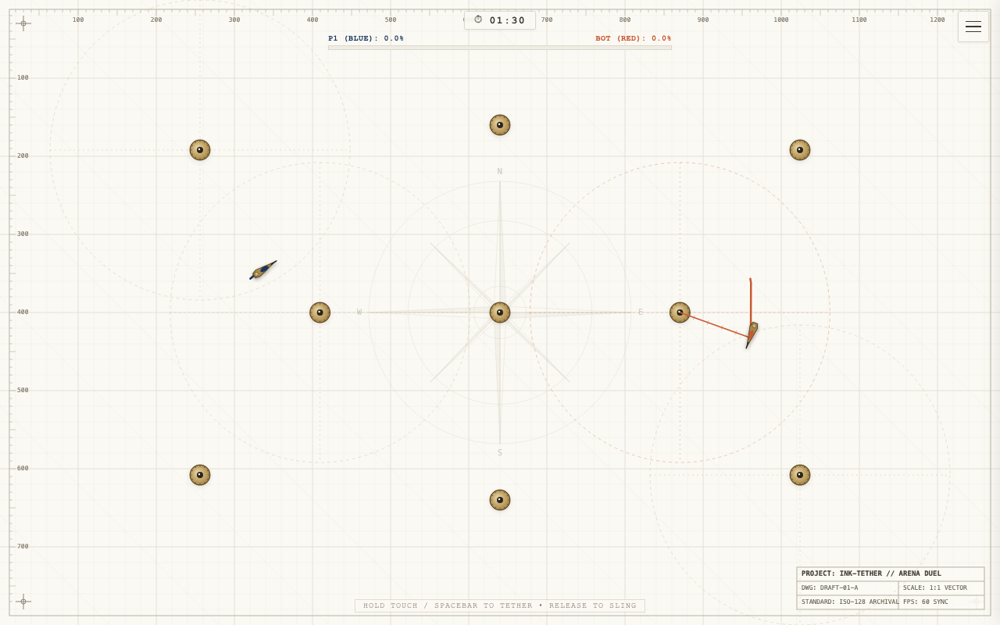
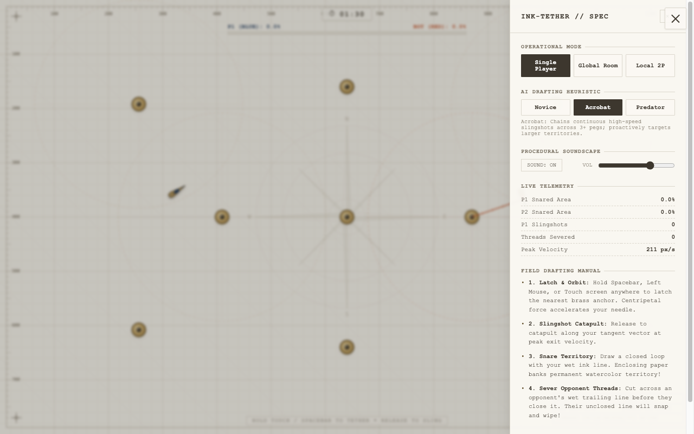

# INK-TETHER

An open-source orbital slingshot and territorial snare duel built with HTML5 Canvas, TypeScript, and the Web Audio API.

**Play Online:** https://vikramlingam.github.io/ink-tether/

The game runs at 60 frames per second directly in modern web browsers with zero installation and zero external assets. All graphics, drafting grids, paper textures, and audio effects are generated procedurally in code.



---

## Game Rules and How to Play

### The Objective
Your goal is to control the majority of the drafting canvas. You have 90 seconds to capture territory. The player who claims the highest percentage of the paper when the timer expires wins the duel. If either player claims 60% or more of the board during the match, they achieve an immediate knockout victory.

### 1. Steering Through Orbital Slingshots
You do not steer your needle using arrow keys or directional pads. Instead, your needle glides forward with momentum and gentle friction:
- **Latching:** Press and hold your input (`Spacebar`, left mouse button, or touch screen). If you are within 240px of any brass anchor, an elastic guideline shoots out and latches onto it.
- **Orbiting:** While holding, your needle enters a circular orbit around the anchor. Rotational speed accelerates based on distance and hold time (up to 9.5 rad/s).
- **Slingshot Release:** Releasing your input snaps the tether and catapults your needle along its instantaneous tangent vector with an exit speed boost.
- **Chaining:** By timing your releases so your tangent trajectory enters the capture zone of another peg, you can chain high-speed slingshots across the arena without touching borders.

### 2. Snaring Territory
As you fly across the paper, your needle leaves behind an active wet ink line:
- To capture territory, draw a complete closed loop.
- The physics engine uses 2D vector segment intersection tests to detect when your line crosses over itself.
- When a loop closes, the enclosed area is computed using the Shoelace formula.
- If the loop is valid (greater than 1400 sq px), the perimeter flashes with an ink bleed effect, the interior fills with your player's translucent watercolor wash and 45-degree architectural hatching lines, and a resonant pentatonic chime sounds.
- Once banked, this territory is permanent and contributes to your live control percentage shown in the top HUD.

### 3. Thread Cutting Combat
Unclosed wet lines are vulnerable:
- While you are drafting a loop, your line is wet and exposed.
- If an opponent flies through any part of your unclosed wet line, the line snaps like a guitar string.
- Your needle suffers kinetic recoil stun and your entire unbanked wet line dissolves, wiping your progress for that loop.
- Cutting opponent lines is the primary defensive counter to stop large territory claims.

### 4. Usurping Territory
If your opponent has already banked a polygon, you can steal it:
- Draw a larger loop that completely encloses your opponent's existing territory.
- When your larger loop closes, any inner enemy polygons flip ownership to your color.

### 5. Tactical Advice
- **Keep Early Loops Modest:** Do not draw massive loops across the entire board early on. Long wet lines are easy targets for opponents to cut.
- **Bait and Sever:** Watch your opponent's trailing line. If they get greedy and draw a long unclosed trail, slingshot across their path to snap it.
- **Boundary Bounces:** The arena perimeter has dampened restitution. You can bounce off walls intentionally to reverse direction without latching onto an anchor.

---

## Minimalist Settings Drawer

All secondary settings, matchmaking options, and telemetry are tucked inside the top-right hamburger drawer:



From the drawer, you can:
- Switch operational modes (Single Player AI, Global Room, Local 2-Player).
- Select bot difficulty (Novice, Acrobat, Predator).
- Generate and copy 5-letter room codes or direct invite links.
- Adjust procedural sound synthesis volume or mute audio.
- View real-time match telemetry (snared percentage, slingshots fired, threads severed, peak velocity).
- Review the quick drafting manual.

---

## Visual and Audio Direction

### Architectural Drafting Canvas
- **Paper Tone:** Warm cream vellum (`#FBF9F4`) with procedural fiber tooth.
- **Grid Lines:** Dual graph guidelines (`#E4E0D5` major 100px grid, `#EFECE3` minor 20px grid) with 45-degree isometric guides.
- **Technical Markings:** Archival corner crosshairs (`+`) with dynamic coordinate readouts, millimeter graduation ticks along the perimeter, and a background compass rose.
- **Title Block:** ISO-128 technical drawing block rendered in the corner.
- **Line Boil:** A 12fps procedural micro-jitter applied to wet lines to replicate hand-drawn fountain pen strokes.

### Procedural Web Audio SFX (0 MB Download)
All sound effects are synthesized procedurally at runtime via the Web Audio API without background noise or external audio files:
- **Tether Spooling:** Mechanical ratchet clicks scaled to rotational speed while orbiting an anchor.
- **Slingshot Snap:** Acoustic whip crack with pitch decay and high-frequency noise.
- **Loop Closure Chords:** Multi-voice pentatonic acoustic chimes with exponential decay, pitched higher for larger snared areas.
- **Thread Snap:** Snapping twang using dual detuned saw and square oscillators with a fast downward pitch dive.
- **Boundary Tap:** Muted drafting ruler tap on canvas edges.

---

## Controls

### Desktop
- **Hold Spacebar or Left Mouse Button:** Latch onto nearest anchor
- **Release:** Slingshot along tangent vector

### Mobile
- **Touch and Hold anywhere on screen:** Latch onto nearest anchor
- **Release Touch:** Slingshot along tangent vector

### Local Two-Player Mode
- **Player 1 (Blue):** Hold `Spacebar` (Desktop) or touch the left half of the screen (Mobile)
- **Player 2 (Red):** Hold `Enter` or `Up Arrow` (Desktop) or touch the right half of the screen (Mobile)

---

## Game Modes

### 1. Offline Single Player Bot
Runs entirely client-side with three selectable difficulty levels:
- **Novice:** Predictable orbit durations (1.0 to 1.8 seconds); focuses on small localized loops.
- **Acrobat:** Evaluates tangent vectors toward neighboring anchors to chain slingshots across 3 or more pegs in rapid succession.
- **Predator:** Tracks the player's unclosed wet line length. When the trail exceeds 200px, it calculates intercept angles to cut your line.

### 2. Global Multiplayer (PeerJS WebRTC)
- Generates 5-letter room codes (e.g., `TETHR`) with direct shareable links (`?room=TETHR`).
- Connects players peer-to-peer using WebRTC data channels with public STUN servers.
- Syncs state packets at 25Hz using Cubic Hermite Spline interpolation for smooth remote movement even under network latency.

### 3. Local Two-Player
- Two players compete on a single screen without needing an internet connection.

---

## Project Structure

```
ink-tether/
├── index.html           # Main HTML document and layout
├── package.json         # Dependencies and project metadata
├── tsconfig.json        # TypeScript configuration
├── vite.config.ts       # Vite bundler configuration
├── LICENSE              # MIT License
├── docs/                # Screenshots and documentation assets
└── src/
    ├── types.ts         # Data models and interfaces
    ├── math.ts          # Geometry, Shoelace area, Hermite splines, intersection tests
    ├── audio.ts         # Web Audio API sound synthesis engine
    ├── renderer.ts      # HTML5 Canvas rendering pipeline and paper aesthetics
    ├── ai.ts            # Bot logic (Novice, Acrobat, Predator)
    ├── multiplayer.ts   # WebRTC PeerJS networking and room matchmaking
    ├── game.ts          # Physics, slingshot simulation, territory snaring, combat
    ├── ui.ts            # Minimalist HUD, settings drawer, and telemetry display
    ├── style.css        # Responsive styling and animations
    └── main.ts          # Application bootstrap and 60fps game loop
```

---

## Getting Started

### Prerequisites
- Node.js (v18 or higher)
- npm (v9 or higher)

### Installation
```bash
git clone https://github.com/vikramlingam/ink-tether.git
cd ink-tether
npm install
```

### Local Development
```bash
npm run dev
```
Open `http://localhost:3000` in your web browser.

### Production Build
```bash
npm run build
npm run preview
```
The compiled static assets will be output to the `dist/` directory, ready for deployment on GitHub Pages, Cloudflare Pages, Vercel, or Netlify.

---

## Contributing

Contributions are welcome. If you want to contribute:
1. Fork the repository.
2. Create a feature branch: `git checkout -b feature/my-feature`.
3. Commit your changes: `git commit -m "Add feature"`.
4. Push to the branch: `git push origin feature/my-feature`.
5. Open a Pull Request.

Please ensure the build passes cleanly (`npm run build`) before opening a pull request.

---

## License

This project is licensed under the MIT License. See the [LICENSE](LICENSE) file for details.
